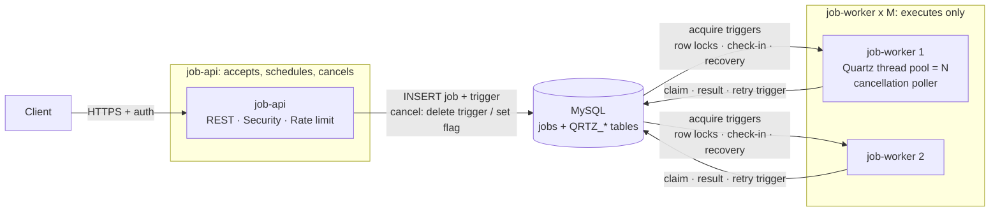

# Job Platform

Two Spring Boot microservices for long-running jobs, built on **Java 21, Spring Boot 3.5, Quartz (clustered
JDBC job store) and MySQL 8.4**:

- **`job-api`** accepts REST calls: it submits one-off jobs and recurring **cron schedules** (into the shared Quartz store), reports their status, and cancels them. It never executes a job.
- **`job-worker`** only executes jobs: it picks them up from the shared store (including each firing of a cron schedule), runs them, retries, recovers from crashed workers, and honours cancellations. It has no REST API.

Each job simulates work with `Thread.sleep()` for a random 1–5 minutes. Both services scale horizontally and
independently.

---

## 1. Run it

You only need **Docker** (Docker Desktop on Windows or macOS). The jar is built inside Docker, so
you don't need a local JDK or Maven.

```bash
docker compose up --build          # MySQL + job-api + 2 job-worker
```

| URL | What |
|---|---|
| `http://localhost:8080` | `job-api` (REST API) |
| `http://localhost:9091`, `:9092` | `job-worker` 1 / 2: actuator only (`/actuator/health`, `/actuator/prometheus`) |
| `localhost:3307` | MySQL (`jobs` / `jobs`) |

Demo users (HTTP Basic): `alice / alice-pass`, `bob / bob-pass`, `admin / admin-pass` (ADMIN).

For a faster demo, shorten the simulated work:

```bash
JOBS_MIN_DURATION=PT10S JOBS_MAX_DURATION=PT30S docker compose up --build
```

`schema.sql` only creates missing tables, it never alters existing ones. If you ran an earlier version
with a different `jobs` table, reset the database volume once: `docker compose down -v`.

### Try it

> On Windows PowerShell, use `curl.exe` instead of `curl`.

```bash
# Submit. "id" is optional (a UUID is generated if omitted). An id can be used only once: repeating the
# call with the same id is rejected with 409 Conflict, so a retried request can never create a second job.
curl -u alice:alice-pass -H "Content-Type: application/json" \
     -d '{"id":"order-42","name":"monthly-report"}' http://localhost:8080/api/jobs

# Schedule for a specific local date-time (no offset; interpreted in JOBS_TIME_ZONE, Asia/Jerusalem in Docker Compose). It stays
# QUEUED, with nextAttemptAt showing when it will run, until then. It must be in the future (400 otherwise);
# omit it to run as soon as a worker is free.
curl -u alice:alice-pass -H "Content-Type: application/json" \
     -d '{"name":"nightly-export","scheduledAt":"2026-10-29T02:00:00"}' http://localhost:8080/api/jobs

# Recurring (cron) job: Quartz syntax, seconds first, '?' in one day field, evaluated in JOBS_TIME_ZONE. Each firing creates an ordinary
# job run. By default a firing is skipped while the previous run is still active ("allowConcurrentRuns": true
# to change that). Schedules that fire more often than once a minute are rejected.
curl -u alice:alice-pass -H "Content-Type: application/json" \
     -d '{"id":"nightly","name":"nightly-export","cron":"0 30 2 * * ?"}' \
     http://localhost:8080/api/schedules
curl -u alice:alice-pass http://localhost:8080/api/schedules/nightly            # incl. nextRunAt
curl -u alice:alice-pass http://localhost:8080/api/schedules/nightly/jobs       # its runs, newest first
curl -u alice:alice-pass -X POST http://localhost:8080/api/schedules/nightly/cancel

# Status (the job itself runs on one of the workers)
curl -u alice:alice-pass http://localhost:8080/api/jobs/<id>

# List jobs (newest first)
curl -u alice:alice-pass "http://localhost:8080/api/jobs?page=0&size=20"

# Cancel (pending: cancelled at once by the API; running: the worker running it interrupts it within ~2s)
curl -u alice:alice-pass -X POST http://localhost:8080/api/jobs/<id>/cancel

# Exercise the retry path: start the workers with a random failure rate, e.g.
#   JOBS_RANDOM_FAILURE_RATE=0.5 docker compose up --build
# Then some attempts fail, are retried with backoff (attempts > 1), and a few jobs end FAILED.

# Operational endpoints
curl http://localhost:8080/actuator/health
curl -u admin:admin-pass http://localhost:8080/actuator/prometheus | grep jobs_   # API metrics
curl http://localhost:9091/actuator/prometheus | grep jobs_                        # worker metrics
```

**Failover demo:** submit a few jobs, run `docker compose kill worker1`, and watch the jobs that worker1 was
running get picked up by worker2 (`workerInstance` changes and `attempts` goes up) after about 10s.
`docker compose stop worker1` (a graceful stop) instead hands its running jobs back to the queue right away,
**without** using up an attempt.

**Separation demo:** `docker compose stop worker1 worker2`. The API keeps accepting and cancelling jobs, and
they wait in `QUEUED`. `docker compose start worker1 worker2`, and the workers pick them up.

### Tests

```bash
docker compose --profile test run --rm tests       # all modules, inside Docker (uses the host's Docker for Testcontainers)
# or, with JDK 21 + Maven installed locally and Docker running:
mvn test                                           # all modules
mvn -pl job-api -am test                           # one service
```

The integration tests run against a **real MySQL via Testcontainers**, so `schema.sql`, Quartz's
clustered store and the row-level race handling are exercised exactly as in production (H2 would hide
locking behaviour).

Each service is tested on its own, with no instance of the other service running. They share only the
database contract, so each suite checks its side of it: the API tests assert what lands in the shared tables,
and the worker tests create jobs exactly the way the API does.

| Module | Test | Covers |
|---|---|---|
| `job-api` | `JobApiIntegrationTest` | submit → `QUEUED` with its trigger in the shared Quartz store, and the API's scheduler is **never started**; a local `scheduledAt` is interpreted in `jobs.time-zone` and becomes the trigger's start time and `nextAttemptAt`; a past `scheduledAt` → 400 and nothing is stored; 401 on missing or wrong credentials; an existing id is rejected with 409 (same body or not, and for other users too: ids are global); cancelling a **queued** job (CANCELLED, trigger deleted) and then 409 on a second cancel; cancelling a **running** job sets `cancelRequested` for the worker; **rate limiting** (429 + `Retry-After`); validation (400); metrics endpoint restricted to ADMIN |
| `job-api` | `JobCronApiIntegrationTest` | creating a schedule registers a Quartz **cron trigger** (expression, evaluated in `jobs.time-zone`) and reports `nextRunAt`; an existing id is rejected with 409; invalid cron (e.g. Unix 5-field syntax), too-frequent cron and never-firing expressions → 400; cancel removes the trigger, a second cancel → 409; unknown schedule → 404 |
| `job-api` | `JobSubmissionConcurrencyTest` | **concurrency:** 16 parallel submissions with the same id create exactly one job; the other 15 get the 409 conflict |
| `job-api` | `SubmissionRateLimiterTest` | per-user minute window: capacity then 429 with a counting-down `Retry-After`, full refill after a minute (not gradual), unused allowance doesn't accumulate, users are independent (unit test, fake clock) |
| `job-worker` | `JobExecutionIntegrationTest` | a job scheduled the way the API does it is picked up and SUCCEEDS; a job scheduled 3s ahead stays QUEUED until then and doesn't start early; **concurrency:** 8 parallel claims of one job, exactly one wins; **failure:** a failed attempt is retried and then succeeds; retries exhausted leads to FAILED; a running job is interrupted and CANCELLED when its cancel flag is set; a job orphaned by a crashed worker is taken over only by Quartz recovery; recovery with no attempts left leads to FAILED; a shutdown interrupt requeues without using up an attempt |
| `job-worker` | `JobCronRunIntegrationTest` | a cron trigger (every 2s) creates runs that execute and SUCCEED as normal jobs; one firing never creates two runs; a firing is **skipped while the previous run is active** unless concurrent runs are allowed; a cancelled schedule creates no runs |

---

## 2. Architecture



```
 job-api                                         job-worker (any instance)
 ───────                                         ─────────────────────────
             ┌──────── one transaction ────────┐
 POST /jobs ─▶ INSERT jobs (QUEUED)              │──▶ 201 {id, status}
             │ INSERT QRTZ trigger (fire now)  │
             └─────────────────────────────────┘
                                │   polls the shared store (every 1s), acquires the trigger under a cluster-wide row lock
                                ▼
                                    UPDATE jobs SET RUNNING ... WHERE status IN (QUEUED,RETRY_PENDING)   ← CAS claim
                                    Thread.sleep(1–5 min)    (no transaction or connection held)
                                    UPDATE → SUCCEEDED | RETRY_PENDING (+ new trigger, backoff) | FAILED | CANCELLED
 POST /jobs/{id}/cancel
   pending: UPDATE → CANCELLED + delete trigger (immediate)
   running: UPDATE cancel_requested = true  ───────▶  poller (every 2s) interrupts the local worker thread → CANCELLED

 POST /schedules ─▶ INSERT job_schedules + Quartz cron trigger (one transaction)
                                    cron trigger fires on one worker (JobCronFireJob):
                                      skip if the schedule is cancelled, or (by default) its previous run is still active
                                      INSERT jobs (id = <scheduleId>-<fireTimeMillis>, schedule_id) + one-shot trigger
                                    → the run executes like any other job, on whichever worker picks it up
```

### Services and modules

The two services never call each other. Their only interface is the database contract in `job-common`.

| Module | Kind | Responsibility |
|---|---|---|
| `job-common` | library jar | The shared contract: `Job` and `JobCron` entities (`dao`), `JobStatus` and `JobCronStatus` (`enums`), `IJobRepository` with the guarded UPDATEs and `IJobCronRepository` (`repository`), `schema.sql`, and the Quartz representation (`quartz`): `QuartzJobs` (keys, JobDetails, one-shot and cron triggers), the `WorkJob` and `JobCronFireJob` classes, and the `IJobRunner` / `IJobCronRunner` interfaces they delegate to. |
| `job-api` | Spring Boot service | REST endpoints, authentication, rate limiting, duplicate-id protection. Writes jobs and triggers, deletes triggers, sets cancel flags. Its Quartz scheduler is **never started**. |
| `job-worker` | Spring Boot service | Executes jobs. A started, clustered Quartz scheduler acquires triggers and runs `WorkJob`, which calls the worker's `IJobRunner`, and `JobCronFireJob`, which calls `IJobCronRunner` to create a run per cron firing. Also the cancellation poller, retries, crash recovery and graceful shutdown. HTTP serves actuator only. |

Interfaces are prefixed with `I`, and callers depend on the interfaces.

**`job-api`** (`com.example.jobs.api`)

| Package | Responsibility |
|---|---|
| `web` | `JobController`, `JobCronController`, `ApiExceptionHandler` (RFC 9457 problem details). No business rules. |
| `dto` | Request/response records (`SubmitJobRequest`, `JobResponse`, `CreateJobCronRequest`, `JobCronResponse`). |
| `service` | `IJobService` / `JobServiceImpl`: submit, get, list, cancel; rejects existing ids. `IJobCronService` / `JobCronServiceImpl`: create (cron, zone and minimum-interval validation), get, list, cancel, runs. |
| `scheduling` | `IJobScheduler` / `QuartzJobScheduler`: `scheduleAttempt`, `unschedule`, `scheduleCron`, `unscheduleCron` and `nextFireTime` against the shared store. |
| `exceptions` | `JobNotFoundException`, `JobCronNotFoundException`, `IdempotencyConflictException`, `InvalidJobStateException`, `InvalidJobCronException`, `InvalidJobCronStateException`. |
| `security`, `ratelimit` | HTTP Basic + roles; per-user submissions-per-minute limit. |
| `config`, `observability` | Properties, clock, MVC config; API metrics. |

**`job-worker`** (`com.example.jobs.worker`)

| Package | Responsibility |
|---|---|
| `execution` | `IJobExecutionService` (extends `IJobRunner`) / `JobExecutionServiceImpl`: the claim / complete / retry / recover state machine, the simulated work, the cancellation poller, and graceful shutdown. `IJobScheduler` / `QuartzJobScheduler`: instance id, retry/requeue triggers, local interrupts. `IJobCronRunService` / `JobCronRunServiceImpl`: turns a cron firing into a job run. |
| `exceptions` | `SimulatedWorkException`. |
| `config`, `observability` | Properties, clock; execution metrics. |

### Job states

```
QUEUED ──▶ RUNNING ──▶ SUCCEEDED
  │          │ ├──(error, attempts left)──▶ RETRY_PENDING ──▶ RUNNING …
  │          │ └──(error, none left)──────▶ FAILED
  └──────────┴──(cancel)──▶ CANCELLED            (RETRY_PENDING can be cancelled too)
```

A job submitted with a future `scheduledAt` stays `QUEUED` until then, and `nextAttemptAt` shows when it will
run. It can be cancelled like any pending job.

`jobs` is the source of truth that the API exposes. Quartz tables only hold *what fires next*. `job-api` creates
jobs, moves `QUEUED`/`RETRY_PENDING` to `CANCELLED`, and sets `cancel_requested`. Every other transition is made by
`job-worker`.

---

## 3. Key decisions and trade-offs

**Two services, coordinated through the shared Quartz store.** The API service and the worker service split along
the line the original design already had: the request side and the execution side only ever communicated through
the database. Now they are separate deployables that scale independently: add API instances for request load and
workers for processing capacity. A worker outage doesn't take the API down; jobs just wait in `QUEUED`.
How each side uses Quartz:
- *`job-api`* has a Quartz scheduler that is configured but **never started** (`spring.quartz.auto-startup=false`).
  A scheduler in that state can still store and delete jobs and triggers in the JDBC store, inside the caller's
  transaction. It never acquires triggers, never checks in with the cluster, and never runs misfire handling, so
  it can't execute anything. `isClustered=true` is still set so its writes use the same DB row locks as the workers.
- *`job-worker`* runs a started, clustered scheduler with the same `scheduler-name` (the shared `SCHED_NAME`). It
  acquires the triggers, executes `WorkJob`, and recovers jobs of workers that died.
- The `WorkJob` class lives in `job-common` because the API's JobDetail must name it. It's a thin adapter that
  delegates to an `IJobRunner`, which only the worker implements.

*Trade-offs:*
- **Shared database.** The services share a schema, which couples their releases: schema changes must stay
  compatible with both. That's deliberate here, because the Quartz store *is* the queue. The alternative is a
  broker (the API publishes `JobSubmitted`, workers consume it, and only the worker owns the `jobs` table). It
  decouples the services fully, at the cost of an outbox, a broker to run, and status reads through an API or a
  read model.
- **Pickup latency.** A scheduler in another process can't wake the workers up, so the workers poll for new
  triggers (`org.quartz.scheduler.idleWaitTime=1000`). New jobs start within about a second, for one small query
  per worker per second.

**Quartz with a clustered JDBC store as the work queue.**
Quartz already solves the hard distributed parts: exactly-one-worker firing (via `QRTZ_LOCKS` row locks),
durable delayed triggers (used for retry backoff), misfire handling, per-worker thread pools, and
**failover**. Workers check in every 10s, and if one stops, the others re-fire its in-flight jobs (`requestRecovery=true`).
Because Spring wires Quartz with `LocalDataSourceJobStore`, a trigger is written **in the same
transaction** as the job row. A job can't be saved without being scheduled, and there's no outbox to build.
*Trade-off:* Quartz serialises trigger acquisition on a DB lock, which is fine for thousands of jobs/hour
but not for millions. At that scale, move to a broker (Kafka/RabbitMQ/SQS) plus an outbox, with the
same `jobs` table and state machine.

**MySQL (InnoDB) for persistence.** Durable, transactional, and shared by all instances. Quartz
supports it natively, and its row locking gives us safe compare-and-set updates. The app talks to MySQL through
`mysql-connector-j`.

**Schema as one idempotent `schema.sql`, no migration tool.** The schema lives in `job-common`, and both services
run it on every startup (`spring.sql.init.mode=always`), so whichever starts first creates the tables. Every statement
is `CREATE TABLE IF NOT EXISTS`, so restarts and several instances starting at once are all safe. The Quartz tables are in the same file. Quartz's own script starts
with `DROP TABLE`, so `spring.quartz.jdbc.initialize-schema=never`. *Trade-off:* there's no schema versioning.
Additive changes (new tables) just work, but altering an existing column means a manual `ALTER` script. Once the
schema starts evolving, I'd add Flyway or Liquibase. Their versioned migrations and startup lock between instances
are what this setup gives up.

**Guarded (compare-and-set) UPDATEs instead of entity locking.** Every transition is
`UPDATE … WHERE id=? AND status IN (…) [AND worker_instance=?]` and checks the affected-row count. Quartz
should never fire a job twice, but if it does (recovery racing with a slow node, a manual re-trigger), at
most one claimer wins. The test proves this with 8 concurrent claimers. The 1–5 minute sleep runs **outside** any
transaction.

**Concurrency limits.** On `job-worker`, `JOBS_MAX_CONCURRENT_PER_INSTANCE` is the Quartz thread-pool size, so
processing capacity is workers × threads. Excess jobs simply wait in `QUEUED`. The number of API instances has no
effect on it.

**Idempotency (duplicate submissions).** The client may choose the job's or cron's `id` in the request body
(URL-safe, up to 100 characters for jobs and 80 for crons); otherwise a UUID is generated. The id is the primary key,
so an id can be used **only once**: submitting an existing id, whatever the body, throws
`IdempotencyConflictException` and returns **409 Conflict**. A client that retries after a timeout therefore never
creates a duplicate; the 409 tells it the first attempt went through, and `GET /api/jobs/{id}` shows its state.
Concurrent submissions with the same id race on the primary key, and every loser gets the same 409. No request
hash is stored, so there's no "same body, return the original" replay. Ids are global, not per user. *Trade-off:* a client-chosen id is reserved for as long as the job row exists, so
reusing an id for a new job only becomes possible after old jobs are archived.

**Scheduled execution.** `scheduledAt` in the submit request is a local date-time without an offset, such as
`2026-10-29T02:00:00`. It's interpreted in the service's zone (`JOBS_TIME_ZONE`) and becomes the start time of the
job's first Quartz trigger, so no extra polling or "due jobs" query is needed. The time is durable in the shared store, and any worker
running at that moment executes it. If no worker is running then, Quartz's misfire handling runs it as soon as one
is. A missing `scheduledAt` means "now"; one that isn't in the future is rejected with 400 (`InvalidScheduledAtException`),
checked in `JOBS_TIME_ZONE`, the zone the time is meant in. *Trade-off:* the time is kept in the existing `next_attempt_at` column (cleared once the
job starts), so there's no schema change, but the originally requested time isn't kept after the job runs. A
dedicated `scheduled_at` column would keep it.
*One zone for everything:* clients send local times, and the service has a single zone (`JOBS_TIME_ZONE`) for both
`scheduledAt` and cron expressions. It's set explicitly rather than taken from the JVM, because inside a container the
JVM default is UTC wherever the users are. *Trade-offs:* clients in other zones must convert to the service's zone
(responses return instants in UTC, e.g. `nextAttemptAt`, so they're unambiguous). Around a DST switch a local time can
be skipped or repeated: a skipped time runs at the first valid instant after the gap, and a repeated one uses the
earlier occurrence (`LocalDateTime.atZone` rules). Changing `JOBS_TIME_ZONE` affects new jobs and schedules only;
existing cron triggers keep the zone they were created with.

**Cron schedules.** A schedule (`POST /api/schedules`) is a definition, not a job: a row in `job_schedules` plus a
Quartz **cron trigger**, written in one transaction. When the trigger fires on a worker, `JobCronFireJob` only
*creates a run*: an ordinary `jobs` row with `schedule_id` set, plus a one-shot trigger, in one transaction. The run
then goes through exactly the same lifecycle as a one-off job (claim, work, retries, cancellation, crash recovery),
on whichever worker picks it up. There is no second execution path to keep correct.
- *Overlap:* by default (`allowConcurrentRuns: false`) a firing is skipped while the previous run is still active.
  This is like Kubernetes' `concurrencyPolicy: Forbid`, and it matters here because runs last 1–5 minutes.
  `JobCronFireJob` is `@DisallowConcurrentExecution`, so the check-then-create can't race with itself.
- *Exactly one run per firing:* the run id is `<scheduleId>-<fireTimeMillis>`, so the primary key rejects a duplicate.
- *Downtime:* firings missed while no worker was running collapse into a single run (`FireAndProceed` misfire
  handling), then the normal cadence resumes.
- *Guard rails:* cron syntax and "fires at least once more" are validated, and expressions that
  fire more often than `jobs.crons.min-interval` (1 minute) are rejected. Schedule creation shares the
  per-user rate limit with job submission.
- *Cancel* stops future firings (row and trigger in one transaction). Runs already created continue, and can be
  cancelled individually as jobs.

*Trade-offs:*
- **Quartz cron syntax** (seconds first, `?` in one day field), not Unix 5-field cron. It's what Quartz executes,
  and it supports seconds and years. A Unix expression gets a 400 that explains the format.
- **Worker crash between firing and run creation.** The schedule's JobDetail doesn't request recovery, so that one
  firing is lost and the next one proceeds. The window is milliseconds. The deterministic run id would make
  recovery safe if it were ever enabled.
- **Pause/resume and editing a schedule's cron** aren't implemented. They map directly to Quartz's
  `pauseJob`/`resumeJob` and `rescheduleJob`.

**Retries.** Exponential backoff (`initial-backoff × multiplier^(n-1)`), with `max-attempts` including the
first attempt. The retry is a new Quartz trigger written in the same transaction as `RETRY_PENDING`, so
it survives restarts. `@DisallowConcurrentExecution` stops a retry from overlapping the previous attempt.

**Interrupted jobs.**
*Crash* (kill -9, OOM, lost host): Quartz recovery re-fires on a live worker, `isRecovering=true` lets that
node take over the `RUNNING` row, and the attempt counts. If no attempts are left, the job goes to FAILED.
*Graceful shutdown* (deploy): running jobs are interrupted, set back to `QUEUED` **without using up an
attempt**, and given a fresh trigger, so another worker starts them right away instead of waiting out a 5-minute sleep.

**Cancellation across services.** The cancel request reaches an API instance while the job sleeps on some worker.
The API cancels a pending job itself: the status change and the trigger deletion happen in one transaction. For a
running job the API only sets `cancel_requested=true`. Every worker polls (one indexed query every 2s) for flagged
jobs **among the ones it is executing** and calls `Thread.interrupt()`. *Trade-off:* up to about 2s of cancellation latency, in exchange for no service-to-service messaging.
Redis pub/sub or a broker topic would make it immediate.

**Authentication and authorization.** On `job-api`: stateless HTTP Basic against configured users, roles USER/ADMIN.
Any authenticated user can read, list and cancel any job (jobs have no owner). ADMIN is additionally
required for the metrics endpoints. *Trade-off:* no per-user isolation. Restoring it means an `owner` column,
ownership checks in `IJobService`, and job ids scoped per user. *Production:* replace `httpBasic()` with
`oauth2ResourceServer().jwt()` against an OIDC provider. That's a single-line change in `SecurityConfig`.
`job-worker` has no API, and its actuator endpoints are unauthenticated: keep its port on the internal network
(or move actuator to a separate management port).

**Rate limiting.** At most `RATE_LIMIT_CAPACITY` (default 10) submissions per user per minute, counting
`POST /api/jobs` and `POST /api/schedules` together. The allowance **refills to full capacity once a minute** (a fixed
one-minute window per user, starting with the user's first submission), not gradually. Over the limit, the response is
429 with `Retry-After` (seconds until the refill). *Trade-offs:* a fixed window lets a user send up to twice the
capacity across a window boundary (the end of one minute plus the start of the next). It's simpler and more
predictable for clients than a gradual refill. The windows are in memory per API instance, so with N instances the
effective limit is up to N × the configured value. That's acceptable as edge protection. For an exact global limit,
keep the windows in Redis (`INCR` + `EXPIRE` per user and minute) behind the same `SubmissionRateLimiter`, or enforce it
at the API gateway.

**Operational visibility.**
- Logs carry `jobId` in the MDC on every line written by a worker. State transitions are logged at INFO, retries at WARN, and permanent failures at ERROR. The `application` metric tag (`job-api` / `job-worker`) tells the services apart.
- Metrics at `/actuator/prometheus` (ADMIN only on `job-api`, internal on `job-worker`):

  | Service | Metric | Meaning |
  |---|---|---|
  | api | `jobs_submitted_total` | Submissions |
  | api | `jobs_submissions_rate_limited_total` | Submissions rejected by the rate limiter |
  | api | `jobs_count{status}` | Cluster-wide queue depth, read from the DB |
  | api | `jobs_schedules_created_total`, `jobs_schedules_cancelled_total` | Cron schedules created and cancelled |
  | worker | `jobs_schedules_runs_created_total`, `jobs_schedules_runs_skipped_total` | Runs created by cron firings, and firings skipped because the previous run was still active |
  | both | `jobs_finished_total{outcome}` | Completions by outcome (the API counts cancellations of pending jobs) |
  | worker | `jobs_retries_total`, `jobs_recovered_total` | Retries, and jobs taken over after a worker failure |
  | worker | `jobs_execution_seconds` | Duration of each attempt |
  | worker | `jobs_running_local` | Jobs running on this worker |
- Health checks: `/actuator/health` (includes DB) and `/actuator/health/liveness|readiness` for Kubernetes probes.

**Spring Boot 3.5 rather than 4.x.** It's the most widely deployed line, and its Testcontainers and Quartz
integrations are mature. Moving to 4.x is mechanical.

---

## 4. Implemented vs. designed

| Requirement | Status |
|---|---|
| Submit / status / cancel / list endpoints | Implemented |
| Scheduling a job for a specific date-time | Implemented (`scheduledAt`) |
| Recurring (cron) jobs | Implemented (`/api/schedules`): create, get, list, cancel, run history; overlap policy. Pause/resume and editing are designed only. |
| Job states, persistence across restarts | Implemented (MySQL, `schema.sql`) |
| Concurrent jobs, configurable per-instance limit | Implemented |
| Multiple instances, failover, graceful requeue | Implemented (clustered Quartz; Compose runs 2 worker instances; the stateless API scales the same way behind a load balancer) |
| Service boundaries | Implemented: `job-api` (accept, schedule, cancel) and `job-worker` (execute), sharing `job-common` |
| Idempotency, retries with backoff, interrupted/failed jobs | Implemented |
| AuthN/AuthZ | Implemented (Basic + roles; no per-job ownership). OIDC/JWT is designed only. |
| Rate limiting | Implemented per instance. Cluster-wide (Redis) is designed only. |
| Logs + metrics | Implemented. Tracing is designed only. |

### Remaining work and how I'd do it

- **Stale-RUNNING reconciler.** If the DB is unreachable at the exact moment a worker records the result,
  the row stays `RUNNING` while Quartz considers the job done. Fix: workers update a `heartbeat_at` column
  every ~30s, and a clustered Quartz cron job re-queues `RUNNING` rows whose heartbeat is older than a few
  intervals and whose `worker_instance` has no live `QRTZ_SCHEDULER_STATE` row. This would run in `job-worker`.
- **Job timeouts.** Add `deadline_at`, and have the worker's poller interrupt and FAIL jobs that exceed it.
- **Results and webhooks.** Store a result reference (e.g. an S3 key), and add an optional `callbackUrl`
  delivered through an outbox with retries.
- **Priorities and fair scheduling.** Quartz trigger priority per tier, or one trigger group per tenant
  with a weighted acquisition plugin. Both need a tenant/owner column on `jobs`, which this version deliberately doesn't have.
- **Data retention.** Archive or delete terminal jobs after N days. Once a job is archived, its id can be reused.
- **Tracing.** Micrometer Tracing + OpenTelemetry, propagating the trace id from the HTTP request into the
  Quartz `JobDataMap`, so a job's whole lifecycle shows up in one trace.
- **Scale beyond Quartz, or decouple the services fully.** `job-api` writes a `JobSubmitted` event through a
  transactional outbox → Kafka (partitioned by job id) → `job-worker` consumers with bounded concurrency. The
  worker then owns the `jobs` table, and the API reads status through a read model or a worker endpoint.
  The CAS state machine and the REST API stay the same.
- **Security hardening.** TLS at the load balancer, secrets from a vault instead of YAML, an audit log of
  cancellations, and per-tenant rate tiers.

---

## 5. Configuration reference

| Service | Env var | Default | Meaning |
|---|---|---|---|
| api | `JOBS_TIME_ZONE` | Asia/Jerusalem (Compose), UTC (app default) | IANA zone in which local `scheduledAt` values and cron expressions are interpreted |
| api | `JOBS_MAX_ATTEMPTS` | 3 | Attempts including the first, stored on each job at submission |
| api | `RATE_LIMIT_CAPACITY` | 10 | Submissions (jobs and schedules) per user per minute; refilled to full every minute |
| api | `JOBS_CRON_MIN_INTERVAL` | PT1M | Minimum time between two firings of a cron schedule |
| worker | `JOBS_MAX_CONCURRENT_PER_INSTANCE` | 4 | Quartz worker threads per worker instance |
| worker | `JOBS_MIN_DURATION` / `JOBS_MAX_DURATION` | PT1M / PT5M | Simulated work range |
| worker | `JOBS_RANDOM_FAILURE_RATE` | 0.0 | Probability that an attempt fails |
| worker | `JOBS_INITIAL_BACKOFF` | PT10S | First retry delay (doubles each time) |
| worker | `QUARTZ_CHECKIN_MS` | 10000 | Cluster heartbeat; failover happens after about this long |
| worker | `QUARTZ_IDLE_WAIT_MS` | 1000 | How often an idle worker polls for new triggers (pickup latency) |
| both | `DB_URL`, `DB_USER`, `DB_PASSWORD` | localhost | MySQL connection |
| both | `spring.quartz.scheduler-name` | `job-scheduler` | Must be identical in both services (shared `SCHED_NAME`) |
